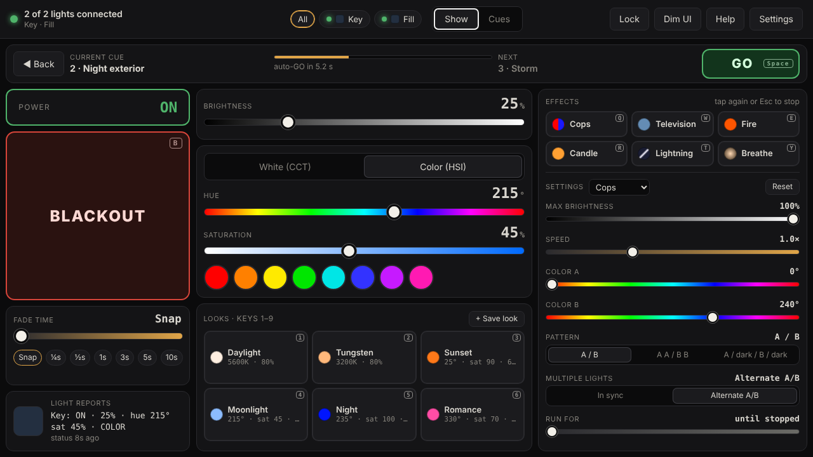
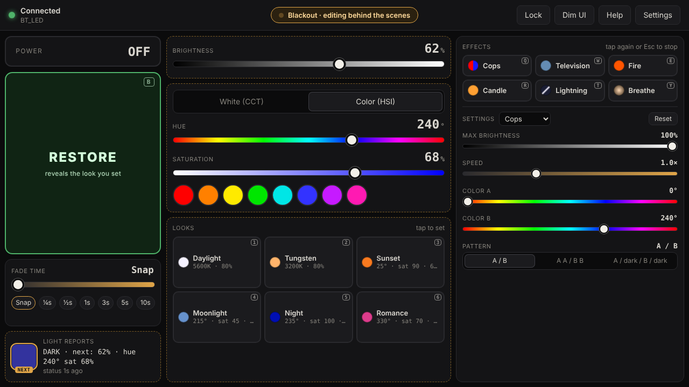

# GVM Show Control

Run a GVM LED light from your laptop like a lighting cue: big Blackout / Restore button, timed fades,
one-tap looks, animated effects (police lights, TV flicker, fire, lightning…), and behind-the-scenes
changes while the light is dark. It's a web page that talks to the light over Bluetooth — nothing to
install, works offline, and no account.

> **Unofficial.** Not affiliated with, endorsed by, or supported by GVM. Use at your own risk.



## What you need
- A **GVM 800-RGB** (shows up as `BT_LED`). Other GVM models may use the same protocol but are untested — see [Other lights](#other-lights).
- **Google Chrome or Microsoft Edge** on macOS, Windows, ChromeOS or Android.
  Safari, Firefox and all iPhone/iPad browsers can't use Bluetooth from a web page; the app tells you this and suggests alternatives.
- Close the GVM phone app first — the light accepts only one connection at a time.

## Use it
1. Open the hosted app in Chrome or Edge: **`https://kyles0623.github.io/gvm-show-control/`**
   (or run it locally, below).
2. Follow the first-run setup: it checks your browser and Bluetooth and walks you through pairing.
3. Optional: install it (Chrome address bar → install icon) for its own window and offline use.

Press **?** in the app for the quick guide, keyboard shortcuts and troubleshooting.

### Run locally instead
Web Bluetooth only works on `https://` or `http://localhost`:
```
bash web/serve.sh        # serves http://localhost:8765 and opens Chrome (macOS)
```
On Windows/Linux, any static server works, e.g. `cd web && python -m http.server 8765`, then open `http://localhost:8765`.

## Features
| | |
|---|---|
| **Blackout / Restore** (`B`) | Snap or fade, 0–10 s, with fine control under 1 s |
| **Behind-the-scenes changes** | While blacked out, adjust brightness, color or pick a look — the light stays dark and comes up in the new look on Restore |
| **Looks** (`1`–`6`) | Daylight, Tungsten, Sunset, Moonlight, Night, Romance |
| **Effects** (`Q`–`Y`) | Cops, Television, Fire, Candle, Lightning, Breathe — each with its own settings (brightness range, speed, colors, pattern…) |
| **Live controls** | Brightness, color temperature (3200–5600 K), hue, saturation |
| **Show safety** | Lock (`L`) disables everything except Blackout; auto-reconnect; keeps the screen awake; dim UI for dark rooms |
| **Fits one screen** | No scrolling on laptop screens 1024×640 and up; stacks on phones |



## Other lights
The protocol was worked out from Bluetooth traffic between the official GVM iOS app and a GVM 800-RGB
([details](docs/TECHNICAL.md#protocol), [captured frames](protocol/gvm-800rgb-frames.json)).
If you have a different GVM model:
1. Settings → Advanced → **Show the Debug tab**. Use **Choose any device…** to connect and see whether the light has the same service (`…0a0b0c0d1910`) and control characteristic (`…0a0b0c0d2b10`).
2. If it does, the app may just work. Please open an issue with the model and what worked.
3. If not, a filtered capture of the official app's traffic (see [protocol/README.md](protocol/README.md)) is what's needed to add support.

The app never writes to firmware-update characteristics and only sends commands seen in real traffic.

## Development
No build step and no dependencies — plain HTML, CSS and ES modules in `web/`.
```
web/            the app (deployed as-is)
  app.js          UI, blackout/staging, looks & effects engine, settings, help
  ble.js          Web Bluetooth connection, reconnect, write queue
  gvm-protocol.js frame encoder/decoder (CRC-16/XMODEM)
  effects.js      looks and effects — easiest place to contribute new ones
  setup.js        browser detection, setup steps, plain-language error messages
protocol/       captured control frames used as test fixtures
tests/          node --test suite (protocol, encoders, effects)
docs/           technical notes and screenshots
legacy/         original SwiftUI explorer (unused)
```
Run the tests (Node 18+): `node --test tests/protocol.test.mjs`

### Deploy your own copy
1. Push this repo to GitHub.
2. Settings → Pages → Build and deployment → Source: **GitHub Actions**.
3. Every push to `main` runs the tests and publishes `web/` (`.github/workflows/pages.yml`).

## License
[MIT](LICENSE)
