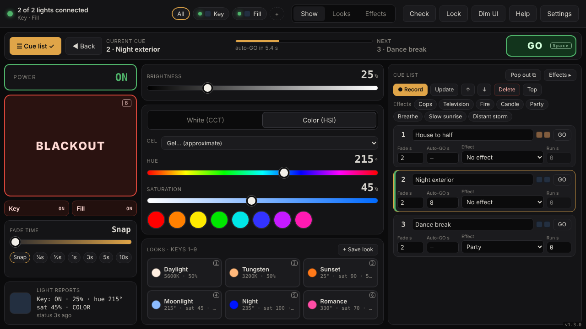
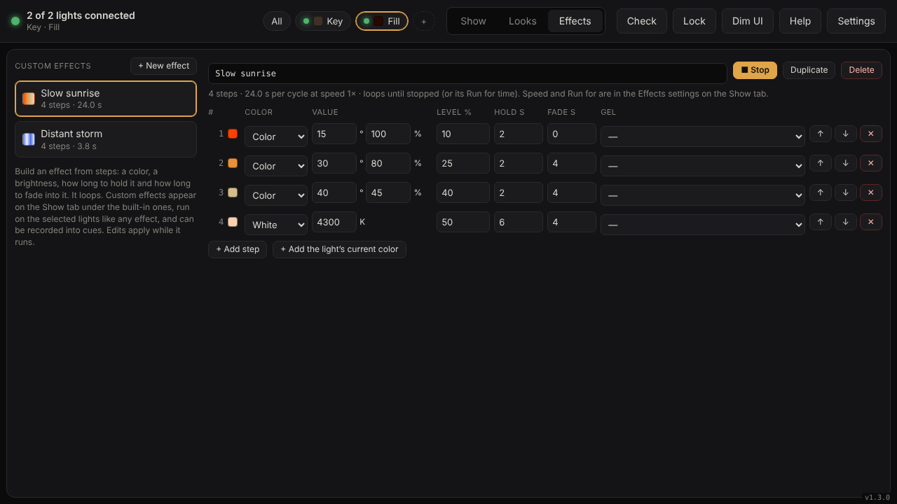

# GVM Show Control

Run one or more GVM LED lights from your laptop like a small lighting console: a cue list with a GO
button, color crossfades, your own saved looks, a big Blackout / Restore button, and animated effects
(police lights, TV flicker, fire, party colors…). It's a web page that talks to the light over Bluetooth — nothing to
install, works offline, and no account. (The hosted app counts visits anonymously with GoatCounter; you can turn
that off in Settings.)

> **Unofficial.** Not affiliated with, endorsed by, or supported by GVM. Use at your own risk.


## What you need
- A **GVM 800-RGB** (shows up as `BT_LED`). Other GVM models may use the same protocol but are untested — see [Other lights](#other-lights).
- **Google Chrome or Microsoft Edge** on macOS, Windows, ChromeOS or Android.
  Safari, Firefox and all iPhone/iPad browsers can't use Bluetooth from a web page; the app tells you this and suggests alternatives.
- Close the GVM phone app first — the light accepts only one connection at a time.

## Use it
1. Open the app in Chrome or Edge: **https://kyles0623.github.io/gvm-show-control/**
   (or run it locally, below).
2. Follow the first-run setup: it checks your browser and Bluetooth and walks you through pairing.
3. Optional: install it (Chrome address bar → install icon) for its own window and offline use.

Press **?** in the app for the quick guide, keyboard shortcuts and troubleshooting.

### Run locally instead
Web Bluetooth only works on `https://` or `http://localhost`:
```
bash web/serve.sh        # serves http://localhost:8765 and opens Chrome (macOS)
```
On Windows/Linux, any static server works, e.g. `cd web && python -m http.server 8765`, then open `http://localhost:8765`.

## Features
| | |
|---|---|
| **Cue list + GO** (`Space`) | Open **☰ Cue list** (`C`) on the Show tab — it takes the place of the Effects column, so the sliders and looks stay next to it. Set the lights, press Record, repeat. **Pop out** puts the list in its own window (e.g. on a second screen); GO/Back keys work there too. Each cue saves every light's look, a fade time, an optional effect with a run time, and an optional auto-GO that fires the next cue by itself. `Shift+Space` goes back. |
| **Multiple lights** | Pair as many as you have (Settings → Lights → Add another light). Chips at the top pick which lights the controls change; `Tab` / `⇧Tab` cycles All → Light 1 → Light 2. Double-click a chip (or the light name in the header) to rename it. The big Blackout covers every light; small per-light buttons under it black out one light at a time. |
| **Color crossfades** | Looks and cues fade brightness, color temperature, hue (the short way round) and saturation together. White ↔ Color changes dip through dark at the midpoint. |
| **Your own looks** (`1`–`9`) | **+ Save look** on the Show tab; rename, reorder, update or delete on the Looks tab. The first nine are one tap / one key away. |
| **Blackout / Restore** (`B`) | Snap or fade, 0–10 s, with fine control under 1 s |
| **Effects** (`Q`–`Y`) | Cops, Television, Fire, Candle, Party, Breathe — each with its own settings (brightness range, speed, colors, pattern, **run for N seconds**). Each light can run its own effect at the same time (e.g. Cops on one, Fire on another); the board shows the selected light's effect, look and settings. With several lights on one effect, Cops can alternate colors and the flicker effects run independently per light. |
| **Live controls** | Brightness, color temperature (3200–5600 K), hue, saturation |
| **Show safety** | Lock (`L`) leaves only GO, Back and Blackout working; auto-reconnect per light; keeps the screen awake; dim UI for dark rooms |
| **Custom effects** | Build your own on the **Effects** tab: a looping list of steps (color or gel, brightness, hold time, fade time). They sit under the built-in effects on the Show tab, run per light, and can be recorded into cues. |
| **Gels** | The **Gel** menu applies approximate gel-style colors (CTO/CTB corrections, ambers, pinks, lavenders, blues, greens) to the selected lights, keeping their brightness. |
| **Pre-show check** | **Check** (top right) confirms every light is connected and answering, dims each one briefly so you can see which is which, and flags cues that use missing lights. |
| **Reliable link** | Every change is confirmed by the light and resent if the confirmation doesn't arrive. A light that stops answering is flagged ("no reply") within about 2 s, reconnected, and put back the way it was, effect included. |
| **Fits one screen** | No scrolling on laptop screens 1024×640 and up; stacks on phones |





## Other lights
The protocol was worked out from Bluetooth traffic between the official GVM iOS app and a GVM 800-RGB
([details](docs/TECHNICAL.md#protocol), [captured frames](protocol/gvm-800rgb-frames.json)).
If you have a different GVM model:
1. Settings → Advanced → **Show the Debug tab**. Use **Choose any device…** to connect and see whether the light has the same service (`…0a0b0c0d1910`) and control characteristic (`…0a0b0c0d2b10`).
2. If it does, the app may just work. Please open a [Light report](https://github.com/kyles0623/gvm-show-control/issues/new?template=light_report.yml) with the model and what worked.
3. If not, a filtered capture of the official app's traffic (see [protocol/README.md](protocol/README.md)) is what's needed to add support.

The app never writes to firmware-update characteristics and only sends commands seen in real traffic.

## Development
No build step and no dependencies — plain HTML, CSS and ES modules in `web/`.
```
web/            the app (deployed as-is)
  app.js          UI, crossfade engine, blackout/restore, cue runner, effects engine, settings, help
  rig.js          the set of paired lights: storage, pairing, auto-connect, selection, shared log
  show.js         looks library + cue list storage, crossfade math
  ble.js          Web Bluetooth connection to one light, reconnect, write queue
  gvm-protocol.js frame encoder/decoder (CRC-16/XMODEM)
  effects.js      looks and effects — easiest place to contribute new ones
  setup.js        browser detection, setup steps, plain-language error messages
protocol/       captured control frames used as test fixtures
tests/          node --test suite (protocol, encoders, effects, crossfade math)
docs/           technical notes and screenshots
legacy/         original SwiftUI explorer (unused)
```
Run the tests (Node 18+): `node --test tests/protocol.test.mjs`

### Deploy your own copy
1. Push this repo to GitHub.
2. Settings → Pages → Build and deployment → Source: **GitHub Actions**.
3. Every push to `main` runs the tests and publishes `web/` (`.github/workflows/pages.yml`).

### Versioning

The version is shown in the app's lower-right corner (and in Settings). It lives in `web/setup.js` (`APP_VERSION`);
the offline cache in `web/sw.js` is named after it, so a new version also makes browsers fetch the new files.

Every commit bumps the minor version (1.4.0 → 1.5.0) through a git hook. Turn it on once per clone:

```sh
git config core.hooksPath .githooks
```

- Skip it for one commit: `SKIP_BUMP=1 git commit ...`
- Major or patch release: `scripts/bump-version.sh major` (or `patch`), then commit; the hook keeps your bump.
- Write release notes under **Unreleased** in [CHANGELOG.md](CHANGELOG.md); the hook files them under the new version.

## Feedback and contributing
- **What's new:** [CHANGELOG.md](CHANGELOG.md) (also: click the version number in the app's corner).
- **Problems and ideas:** [open an issue](https://github.com/kyles0623/gvm-show-control/issues/new/choose), or use
  **Help → Report a problem** in the app, which fills in your version and browser.
- **Other GVM lights:** a *Light report* issue tells us what works on your model.
- **Contributing:** see [CONTRIBUTING.md](CONTRIBUTING.md) (including the rules for protocol changes), the
  [code of conduct](CODE_OF_CONDUCT.md) and [security notes](SECURITY.md).

## License
[MIT](LICENSE)
